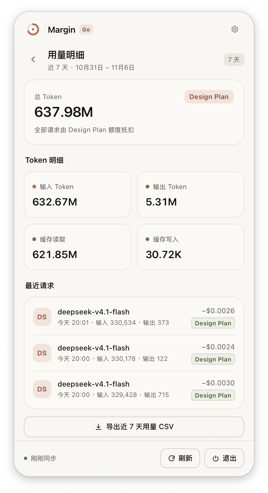
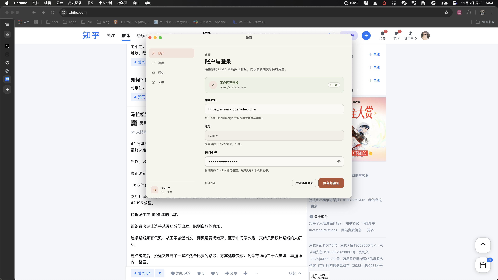
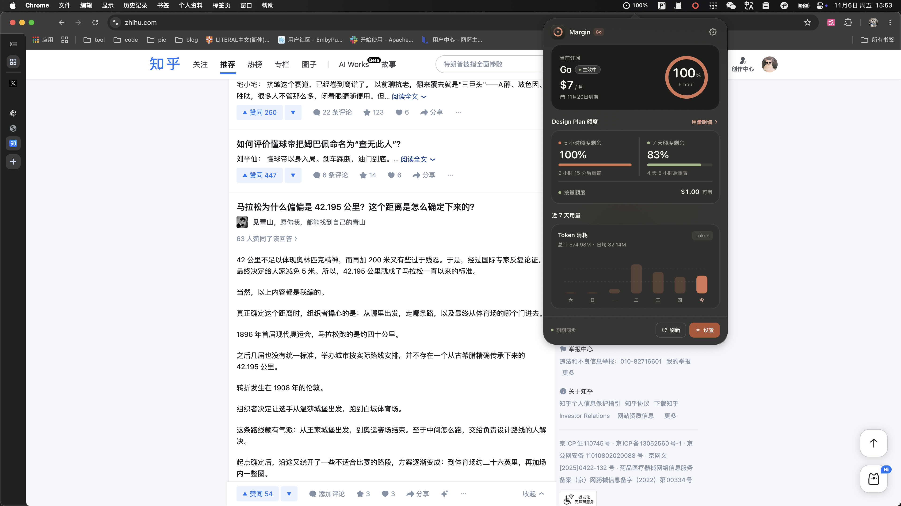

# Margin

OpenDesign 订阅用量，挂在 macOS 菜单栏上的一个小面板。

原生壳（AppKit + WKWebView），无 Xcode 依赖，arm64，单文件 App。


---

## 它做什么

OpenDesign 的订阅额度和用量只在网页控制台里能看到，这个 App 把它压到菜单栏：

- **菜单栏常驻**：环形图标实时显示 5 小时窗口剩余百分比，点一下弹出面板
- **面板**：当前订阅（档位 / 价格 / 到期日）、5 小时与 7 天额度、按量钱包、近 7 天 Token 柱状图
- **用量明细**：总 Token、输入/输出、缓存读写、最近请求，按天翻页取全量
- **导出 CSV**：近 7 天汇总 + 全部请求明细，写到 ~/Downloads，完成后通知
- **多工作区**：账号下有多个工作区时可在设置里切换
- **通知**：剩余额度低于阈值时提醒（阈值 0–100% 可调）
- **主题**：跟随系统 / 浅色 / 深色

| 明细页 | 设置 |
|---|---|
|  |  |

深色模式：



---

## 安装

到 [Releases](../../releases) 下载最新的 `Margin-v*.zip`，解压后把 `Margin.app` 拖进 `/Applications`。

首次打开会被 Gatekeeper 拦一次（未签名）：

- 右键点击 App → **打开** → 再点一次「打开」；
- 或者 `xattr -dr com.apple.quarantine /Applications/Margin.app`。

系统要求：macOS 14+，Apple Silicon。

---

## 首次使用

1. 菜单栏出现环形图标，点开面板；
2. 点「用浏览器登录」，会在默认浏览器打开 OpenDesign 登录页；
3. 在浏览器里登录完成后**什么都不用做** —— App 每 2 秒检查一次浏览器的 Cookie 库，登录一完成就自动导入并校验，面板变成「登录成功」；
4. 如果浏览器已经登录过，点按钮后约 4 秒就会连上。

读不到时会给出提示；Chrome / Edge / Brave 都支持（包含 Profile 1/2/3 多配置文件）。

---

## 设置

- **账户**：连接状态、工作区切换、用浏览器登录 / 退出登录
- **通用**：主题、菜单栏显示（百分比 / 环形）、开机自启、刷新间隔（5–60 分钟）
- **通知**：额度不足提醒（阈值）、本期结束提醒、每周摘要
- **关于**：版本、检查更新、退出

菜单栏图标右键还有：刷新、从浏览器同步登录态、退出登录、退出 Margin。

---

## 数据来源

数据来自 OpenDesign 网页端自己用的只读接口（`amr-api.open-design.ai`），**不是公开 API**，也没有官方文档。接口返回结构记在 [docs/03-data-api.md](docs/03-data-api.md)，全部字段都是实测抓下来的。

因此：

- 接口一变，App 就会读不到数据（会显示错误原因，不会崩）；
- 不写入任何数据，只做 GET。

---

## 隐私

- 会话 Cookie 只保存在本机：`~/Library/Application Support/com.ryan.margin/session.token`，权限 0600；
- 不上传任何数据，没有统计、没有第三方 SDK；
- 导出的 CSV 只写在本地 `~/Downloads`；
- 读取浏览器 Cookie 时会临时复制一份 profile 到临时目录，读完立刻删除。

---

## 技术实现

```
菜单栏图标  NSStatusItem（环形 NSImage，按百分比绘制）
面板        NSPanel(.borderless/.nonactivating) + NSVisualEffectView + 26pt 圆角遮罩
界面        WKWebView + HTML/CSS/JS（popover.html / settings.html）
桥接        window.webkit.messageHandlers.bridge ↔ window.margin.*
数据        URLSession + Codable DTO → StateBuilder（纯函数）→ PanelState → 前端
```

几个实现上的取舍：

- **不用 Xcode**：`swiftc` 直接编译，`Makefile` 组装 `.app` 并 ad-hoc 签名，方便脚本化和分发；
- **界面用 Web**：圆角、渐变、图表用 CSS/SVG 写比 AppKit 快得多，代价是要处理高度同步（用 `ResizeObserver` 上报内容高度，原生侧 clamp 到 220–760pt）；
- **token 存文件而不是 Keychain**：ad-hoc 签名下每次重编译 Keychain 都会重新弹窗，文件 + 0600 更顺手。

---

## 开发

```bash
make app     # 编译 + 组装 build/Margin.app + ad-hoc 签名
make run     # 重新编译并启动
make check   # 类型检查
make test    # 纯函数自测（7 天窗口、价格匹配、状态映射等 13 项）
```

目录：

```
Sources/            原生层（约 3.1k 行）
  AppDelegate.swift     生命周期、菜单、登录、导出、通知
  UsageStore.swift      取数编排、缓存、状态构造（含 StateBuilder 纯函数）
  PanelController.swift 面板窗口与高度
  SettingsWindow.swift  设置窗口
  OpenDesignAPI.swift   只读接口客户端（带退避重试）
  BrowserSessionImport  从浏览器读会话
Resources/web/       界面（popover.html / settings.html / settings.js）
docs/                设计文档、接口实测、界面截图
fixtures/            抓包与原型（`captured/` 含个人数据，不入库）
```

---

## 已知限制

- 登录依赖 Chromium 系浏览器的 Cookie 库；用 Safari / Firefox 登录时读不到（会提示失败）；
- Chrome 大版本更新后读取方式可能失效——那时需要重新适配；
- 只做了 arm64 + ad-hoc 签名，没有做 notarization；
- 接口没有公开文档，字段含义靠实测推断。

---

## License

MIT
